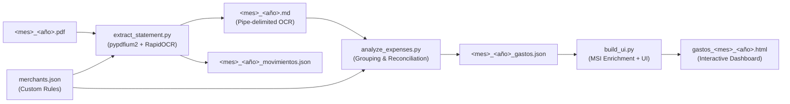

# Santander Statement Expense Analyzer


A local-first OCR and expense reporting pipeline that extracts monthly **Santander (Mexico)** credit card statements (scanned image PDFs), reconciles every charge and credit to the cent, and generates a **self-contained interactive HTML dashboard**.

> **Designed for AI Agents first:** You don't need to memorize or run CLI commands manually every month. This repository includes a detailed [`AGENTS.md`](AGENTS.md) instruction file so your AI coding assistant (Cursor, Claude Code, Antigravity, Windsurf, GitHub Copilot, OpenCode, etc.) can run the entire extraction, merchant categorization, reconciliation, and HTML build workflow for you from a single prompt.

---

## ✨ Key Features

- 🤖 **AI-First Workflow (`AGENTS.md`)** — Drop your monthly PDF statement into the folder and ask your AI agent to process it. The agent knows how to activate the virtual environment, run OCR, verify that `delta charges` and `delta credits` equal `0.0`, help you categorize new merchants, and generate the final HTML report.
- 🔒 **100% Local OCR & Privacy-Safe** — Uses `pypdfium2` and `rapidocr-onnxruntime` (local ONNX models) to read scanned statement PDFs on your machine. Sensitive `.pdf` statements, intermediate `.md`/`.json` files, and `.html` reports are ignored by [`.gitignore`](.gitignore) so personal financial data is never committed.
- 🧮 **Automatic Reconciliation** — Parses `Periodo`, `Total de cargos`, and `Total de abonos` directly from the statement and verifies that extracted transactions match official bank totals (`delta = 0.0`).
- 🏦 **Built for Santander Statement Quirks**:
  - **MSI (Meses Sin Intereses) De-duplication & Enrichment**: Prevents double-counting the top `COMPRAS Y CARGOS DIFERIDOS A MESES SIN INTERESES` schedule table while automatically enriching monthly `AMAZON A MESES` cutoff charges with their original purchase date, original amount, and remaining balance.
  - **Signless Credits Detection**: Automatically identifies transfers, refunds, and verification reversals (`PAGOPORTRANSFERENCIA`, `SANTA <RFC>`, `TOTALPLAYAPPREGCR`) that Santander prints without a `+` or `-` sign column.
  - **Smart Descriptor Splitting**: Distinguishes **Uber Eats** (`food_delivery`) from **Uber Rides** (`uber_rides`) across multiple PayPal and DLO descriptors.
- 📊 **Self-Contained Interactive HTML Dashboard** — Generates a single offline-ready `gastos_<mes>_<año>.html` file with:
  - Collapsible merchant groups sorted by net spend
  - Instant search by merchant, date, or custom tag
  - Quick filters (All groups, Amazon items only, Untagged Amazon items, Uber Eats)
  - Item-level notes/tags saved in `localStorage` with one-click JSON export/import

---

## 🚀 Quick Start

### 1. Clone & Set Up the Environment

Requires **Python 3.10+**. Create a local virtual environment and install the dependencies (or simply ask your AI agent to set up the environment following [`AGENTS.md`](AGENTS.md)):

```bash
python -m venv venv
```

Activate the virtual environment:
- **Windows (PowerShell)**:
  ```powershell
  .\venv\Scripts\Activate.ps1
  ```
- **Windows (CMD / Git Bash)**:
  ```bash
  venv\Scripts\activate
  # or in Git Bash:
  source venv/Scripts/activate
  ```
- **macOS / Linux**:
  ```bash
  source venv/bin/activate
  ```

Install dependencies:
```bash
pip install -r requirements.txt
```

---

## 🤖 How to Use (Ask Your AI Agent)

The main idea of this project is that **you don't need to run the scripts manually**. Because [`AGENTS.md`](AGENTS.md) documents the exact pipeline architecture, CLI flags, reconciliation checks, and domain rules, your AI assistant already knows what to do.

1. Save your monthly Santander PDF statement in the project root using the `<mes>_<año>.pdf` naming convention (e.g., `nov_2026.pdf`).
2. Ask your AI agent:

> *"Process `nov_2026.pdf` following `AGENTS.md` and generate the HTML expense report."*

### What the AI Agent Will Do Automatically:
1. Run `extract_statement.py` to OCR the movement pages into `nov_2026.md` and `nov_2026_movimientos.json`.
2. Run `analyze_expenses.py` to classify merchants using [`merchants.json`](merchants.json) and verify that `delta charges` and `delta credits` are both `0.0`.
3. Check if any unrecognized merchants appeared under their raw bank description. If so, the agent can ask you how to group them (or infer the category), update [`merchants.json`](merchants.json), and re-run the analysis.
4. Run `build_ui.py` to output `gastos_nov_2026.html`.

### Other Prompts You Can Give Your AI Agent:
- *"I added `dic_2026.pdf`, please generate the dashboard and add any new merchants you find to `merchants.json`."*
- *"In `nov_2026.pdf`, the movements span pages 4 to 7 instead of 4 to 6. Extract all of them and make sure the totals reconcile."*
- *"Group all `SPOTIFY` and `APPLE.COM/BILL` charges under a new `Subscriptions` category in `merchants.json` and rebuild the HTML."*

---

## 🛠️ Customizing `merchants.json` for Your Own Needs

> [!IMPORTANT]
> The [`merchants.json`](merchants.json) file included in this repository is configured for the original author's personal merchants and subscriptions. **You must update [`merchants.json`](merchants.json) to match your own spending habits, recurring services, and card descriptors.**

You can edit [`merchants.json`](merchants.json) manually or ask your AI agent to update it whenever new charges appear on your statement. It contains three sections:

### 1. `replacements`
A list of `[pattern, replacement]` regex pairs used to clean up OCR spacing artifacts or normalize cryptic bank descriptors before classification:
```json
"replacements": [
  ["DLODELUBEREATS", "DLO DEL UBER EATS"],
  ["AMAZONAMESES", "AMAZON A MESES"],
  ["PAGOPORTRANSFERENCIA", "PAGO POR TRANSFERENCIA"]
]
```

### 2. `credit_keywords_without_plus`
Santander statements print a `+` column for charges, but payments, refunds, and $0.01 verification reversals often have **no sign symbol** in the PDF. Any line (in lowercase without spaces) matching these keywords when `+` is absent will be treated as a credit/abono (`-`):
```json
"credit_keywords_without_plus": [
  "pagoportransferencia",
  "santa",
  "totalplayappregcr"
]
```
*If you receive refunds or payments under another descriptor without a `-` sign, add its compact lowercase keyword here so your credits reconcile to `0.0`.*

### 3. `rules`
An ordered list of merchant classification rules evaluated top-to-bottom. The first matching rule assigns the transaction's display `group` and internal `group_key`:
```json
"rules": [
  {
    "group": "Food delivery (Uber Eats)",
    "group_key": "food_delivery",
    "match": ["UBRPAGOSMEX", "UBRFLEXMEX", "UBEREATS"]
  },
  {
    "group": "Uber rides",
    "group_key": "uber_rides",
    "match": ["DLOUBER", "DLO UBER"],
    "exclude": ["EATS"]
  },
  {
    "group": "Amazon",
    "group_key": "amazon",
    "match": ["AMAZON"]
  }
]
```
- `group`: Display name shown in the HTML report header for that category.
- `group_key`: Identifier used by the UI (note: `"amazon"` enables per-item tagging badges and `"food_delivery"` feeds the top summary card).
- `match`: Substrings to match (case-insensitive, checked both with and without spaces).
- `exclude` *(optional)*: Substrings that disqualify the rule if present.
- `match_first_word` *(optional)*: Matches only against the first word of the description (e.g., `["SANTA"]` for Santander bonificaciones).

Any transaction that does not match a rule in `merchants.json` is never lost—it automatically falls back to its own raw description (`group_key: "other"`) so you or your AI agent can spot it immediately and add a rule.

---

## 💻 Manual CLI Usage (Optional)

If you prefer running the pipeline yourself from the terminal (with `venv` activated):

```bash
# 1. Extract OCR Markdown and raw movements JSON from <mes>_<año>.pdf
python extract_statement.py nov_2026

# 2. Classify merchants and reconcile totals into <mes>_<año>_gastos.json
python analyze_expenses.py nov_2026

# 3. Build self-contained dashboard gastos_<mes>_<año>.html
python build_ui.py nov_2026
```

### Advanced CLI Flags

| Script | Common Optional Flags | Description |
| :--- | :--- | :--- |
| [`extract_statement.py`](extract_statement.py) | `--pages 3 4 5`<br>`--scale 3.5`<br>`--period "..."`<br>`--config merchants.json` | `0`-based PDF page indices to OCR (default `3 4 5` = pages 4–6). Increase/adjust if your statement has more movement pages. |
| [`analyze_expenses.py`](analyze_expenses.py) | `--expected-charges 31200.50`<br>`--expected-credits 27215.04`<br>`--config merchants.json` | Override auto-detected `Total de cargos` / `Total de abonos` when verifying reconciliation deltas. |
| [`build_ui.py`](build_ui.py) | `--title "..."`<br>`--heading "..."`<br>`--out gastos_nov_2026.html` | Customize the HTML title, heading, `localStorage` key, or output path. |

---

## 🏗️ Pipeline Architecture



---

## 🔒 Privacy & Git Ignore Policy

Bank statements contain sensitive personal data. The included [`.gitignore`](.gitignore) is strictly configured to **block**:
- `*.pdf`, `*.png`, `*.jpg`, `*.jpeg` (raw statements and rendered page images)
- `*.md` and `*.json` (except `README.md`, `AGENTS.md`, and `merchants.json`)
- `*.html` (generated expense dashboards)

Before pushing to a public fork, always verify with `git status` that only code, documentation, and sanitized rules are tracked.
